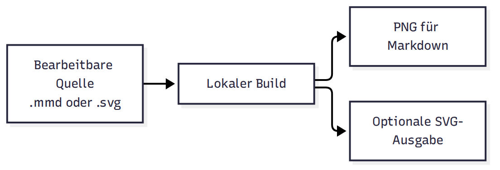

# Grafiken und Diagramme

Dokumentationsgrafiken sollen direkt in Markdown lesbar sein, auch auf schmalen Displays und ohne
Mermaid- oder SVG-Vorschau. PNG ist deshalb die Standardansicht. Eine Abbildung braucht einen
aussagekräftigen Alt-Text, einen anklickbaren Link zur PNG-Großansicht und erläuternden Text.
Diagramme mit zu vielen Details werden in eine Übersicht und thematische Einzelbilder aufgeteilt.

## Quellen und Ausgaben

- Mermaid wird ausschließlich in `.mmd` bearbeitet. Das Skript erzeugt daraus `.png` und auf Wunsch
  zusätzlich `.svg`. Eine vorhandene Mermaid-SVG wird bei der nächsten Erzeugung ebenfalls
  aktualisiert.
- Bei einem ursprünglich als SVG erstellten Diagramm bleibt `.svg` die bearbeitbare Quelle; das
  Skript erzeugt daneben `.png`. Liegen `.mmd` und `.svg` mit demselben Namen vor, gilt die SVG als
  Mermaid-Ausgabe.
- Quellen und Ausgaben werden gemeinsam versioniert. Die Prüfsummen in
  [`.diagram-manifest.json`](../.diagram-manifest.json) werden vom Build-Skript gepflegt und nicht
  manuell bearbeitet.
- Verlinke Repository-Dateien mit relativen Pfaden, nie mit fest codierten Branch-URLs oder externen
  Bilddiensten. Verwende ausreichend Kontrast und Beschriftungsgröße; prüfe PNGs auch in heller und
  dunkler GitHub-Darstellung.

## Beispiel

Die folgende neutrale Prozessübersicht illustriert die Mermaid-Quelle und ihre Ausgaben:

[](diagrams/diagram-pipeline.png?raw=1)

[PNG vergrößert öffnen](diagrams/diagram-pipeline.png?raw=1) ·
[Mermaid-Quelle](diagrams/diagram-pipeline.mmd) ·
[SVG-Datei](diagrams/diagram-pipeline.svg)

Die `.mmd`-Datei ist die bearbeitbare Quelle. Der lokale Build erzeugt die eingebettete PNG-Ansicht
und optional die SVG-Datei; die Markdown-Seite erklärt den Inhalt zusätzlich als Text.

## Lokal erstellen und prüfen

```text
python scripts/diagrams.py build          # PNGs aus Mermaid- und SVG-Quellen erstellen
python scripts/diagrams.py build --svg    # bei Mermaid zusätzlich SVG-Ausgaben erzeugen
python scripts/diagrams.py check          # Quellen, Prüfsummen und Markdown-Einbettung prüfen
python scripts/check.py                   # führt die Diagrammprüfung ebenfalls aus
```

Zum Erzeugen wird Node.js 22.13+ mit npm benötigt. Die festgelegten Versionen von
`@mermaid-js/mermaid-cli` und `sharp-cli` stehen in `.mermaid-cli-version` und
`.sharp-cli-version`; `npm exec` lädt sie bei Bedarf. Der normale Projektcheck benötigt weder Node.js
noch einen Renderer, wenn das Projekt keine Diagrammquellen enthält. Er prüft Diagramme offline auf
fehlende oder seit dem letzten Build veraltete Ausgaben, ohne sie automatisch zu verändern.
Unter Linux benötigt Mermaid CLI außerdem die Chromium-Laufzeitbibliotheken von Puppeteer.

Lege Diagramme neben ihren Markdown-Seiten in `docs/diagrams/` oder in einem thematischen
Unterordner ab. Nach jeder Quellenänderung Build ausführen, anschließend die Abbildung in einem
schmalen Ansichtsfenster sowie mit hellem und dunklem Seitenhintergrund prüfen. Bei entfernten
Quellen auch deren generierte Ausgaben und Manifest-Eintrag entfernen.
